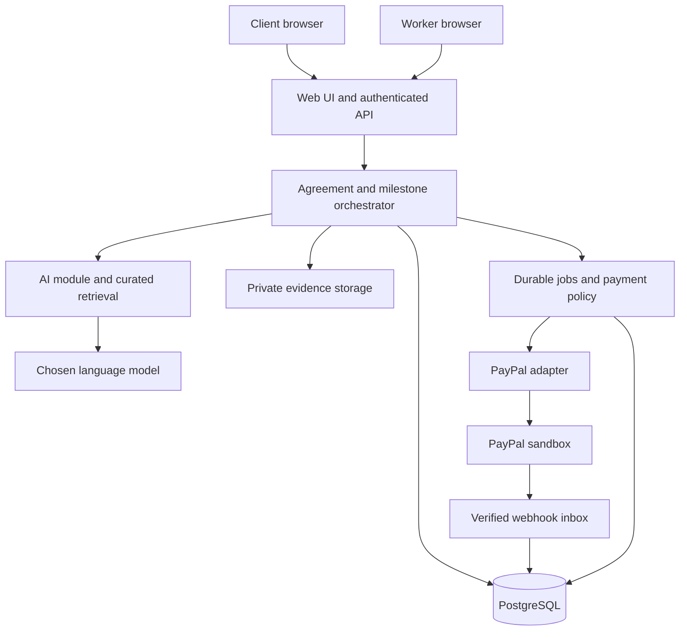
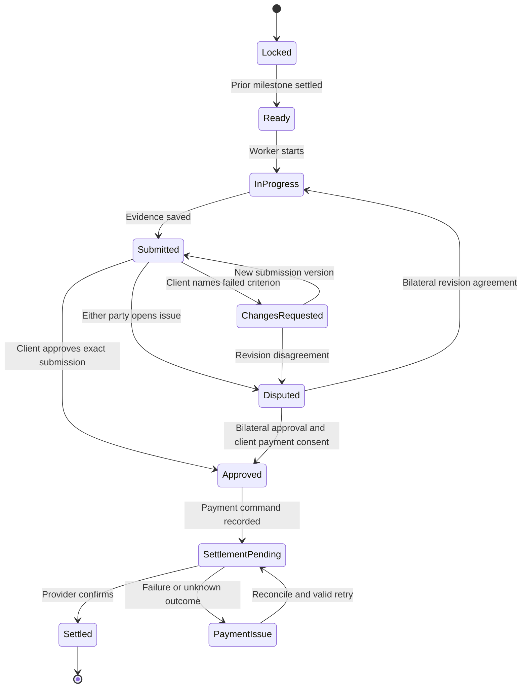

# PayPal Agent Mediated Gig Agreements

System design and eight day implementation plan  
Prepared 1 November 2026 for a three person hackathon team

## 1 Decision and scope

Build an agreement and milestone payment workspace for a client and an independent contractor who already found each other elsewhere. The product converts their different expectations into a mutually accepted scope, tracks submissions against that scope, and executes a PayPal payment action after an authorized human approval. It does not need job listings, matching, bidding, ratings, payroll, or a marketplace feed.

Recommended architecture: one TypeScript application with clear internal module boundaries, one PostgreSQL database, private object storage, and one background worker from the same repository. The AI proposes terms and assesses evidence; deterministic application rules authorize actions; the payment adapter executes them. No model receives payment credentials or unrestricted payment tools.

The eight day target is a real PayPal sandbox prototype for one client, one worker, USD, fixed price digital projects, and up to three sequential milestones. Demonstrate a seven day chatbot implementation project. Support a single seeded worker merchant in the baseline sandbox demonstration; connecting arbitrary real sellers is separate work.

The payment capability decision in section 3 must happen on day one. A real upfront deposit and an authorization hold are different product promises. The team must not silently substitute one for the other.

## 2 Architecture review and corrections

This is a design review against public documentation, not a claim that your accounts or integration have passed live tests.

| Initial risk | Correction incorporated into this design | Remaining limitation |
| --- | --- | --- |
| Calling a generic checkout an escrow service | Use precise payment mode labels and never receive client money into the platform account to simulate escrow | Production custody and agreement terms require their own approval and review |
| Assuming delayed disbursement is available | Day one sandbox capability test with actual account permissions | Production availability is not demonstrated by sandbox success |
| Funding one $300 capture and assuming arbitrary partial release | Map one milestone to one independently controlled payment transaction | Three upfront checkout approvals in the conservative design |
| Treating an authorization as guaranteed deposited funds | Separate reserved, captured, disbursed, refunded, and voided balances | Capture can fail after authorization |
| AI deciding that work is 30 percent complete | Use explicit milestone acceptance criteria and human decisions | Subjective quality disputes remain possible |
| Contract prose and payment values drifting apart | Structured agreement is the source of truth; render prose and money plan from it | Semantic review by both parties still matters |
| Acceptances becoming stale after edits | Immutable versions, canonical hash, both acceptances on the same version | Click acceptance does not establish universal enforceability |
| Client refusing to review forever | Review deadlines, reminders, worker pause, and dispute record | No guaranteed collection through the app |
| AI inventing laws or enforcing worldwide rules | One declared template jurisdiction, curated source metadata, missing source abstention | No worldwide legal compliance claim |
| A retry paying twice | Durable payment operations, unique keys, provider idempotency where supported, reconciliation | External API and database cannot be committed atomically |
| Links changing after submission | Upload an evidence snapshot and save hashes; keep the URL as supplementary evidence | A hash proves the stored bytes, not the quality of work |
| Three separate services slowing integration | Internal modules, shared schemas, mock adapters, one repository | Shared schema and migration ownership must be disciplined |

## 3 PayPal payment design and the day one decision

### 3.1 Verified provider constraints

PayPal delayed disbursement needs approved partner access and a seller enabled for DELAY_FUNDS_DISBURSEMENT. It automatically disburses after 28 days. Its documented release request references a capture transaction. This design therefore uses separate milestone captures rather than assuming a partial amount can be released from one capture. Source: [PayPal delayed disbursement](https://developer.paypal.com/platforms/checkout/delayed-disbursement/).

PayPal authorization can reserve funds for up to 29 days, with a three day honor period. Later capture depends on risk and available funds. Reauthorization creates a replacement authorization ID. Partial capture needs account enablement, so the baseline avoids it. Source: [Authorization and honor period](https://developer.paypal.com/payment-methods/auth-honor/).

### 3.2 Two valid modes with different promises

| Decision | A Captured funds with delayed disbursement | B Authorize each milestone then capture |
| --- | --- | --- |
| Fit to the requested upfront deposit | Closest supported design, conditional on provider permissions | Explicit compromise: funds reserved rather than deposited |
| Funding | Three CAPTURE orders, each using the onboarded worker as payee and DELAYED disbursement | Three AUTHORIZE orders in the seeded worker merchant account |
| Upfront client approvals | Three separate approvals in the conservative MVP | Three separate approvals in the conservative MVP |
| After approval of milestone | Disburse that milestone's capture using referenced payout operation | Capture that milestone's entire authorization |
| Recipient | Onboarded worker merchant | Seeded worker sandbox merchant |
| Unused money | Refund eligible unreleased captures through the seller context | Void uncaptured authorizations |
| Critical dependency | Partner permission, seller feature, referenced release and refund permissions | Successful authorize, full capture, void and reauthorization tests |
| Honest interface label | Captured awaiting disbursement | Authorized awaiting capture |
| Worker assurance | Captured funding is stronger evidence, subject to provider action and disputes | Reservation is not a payment guarantee |

**Recommended decision:** test A immediately. Select it only if create, capture, release, verification, and refund all actually work in your sandbox by the first two to three hours. Otherwise implement B for the hackathon, disclose the changed funding semantics in the product and pitch, and keep A as the documented production direction. If an actual deposit is nonnegotiable, A's access is a launch dependency; B does not fulfill that requirement.

Implement one selected route during the sprint. Do not spend eight days completing two payment products. Persist `payment_mode` on the agreement before acceptance and prohibit switching after funding starts.

Do not assume that adding an arbitrary payee to ordinary checkout grants a platform permission to act for that seller. In B, the configured sandbox merchant is the worker receiving the payment. In A, use the actual supported partner authorization and seller onboarding flow. Never ask a worker for their PayPal password or have a browser send secret credentials.

### 3.3 Funding plan for the demonstration

| Milestone | Target from activation | Deliverable | Gross USD |
| --- | --- | --- | ---: |
| M1 | Day 2 | Conversation flow, approved FAQ dataset, clickable prototype | 40 |
| M2 | Day 5 | Working chatbot in staging, FAQ and human handoff behavior | 110 |
| M3 | Day 7 | Agreed test report, deployment guide and final handover archive | 150 |
| Total | | | 300 |

A completion percentage is informational and never determines money. These are negotiated fixed amounts. Store integer cents: 4000 + 11000 + 15000 = 30000. The $40 is gross; show provider fee and net values when available. Zero platform fee in the MVP. A promise that the worker receives exactly $40 net would require a separately agreed and verified fee treatment.

For A, create and capture each order separately before work starts. For B, create and authorize each separately. The application marks the agreement ready to work only when every required funding record is provider confirmed. Funding is not atomic across three orders: if the client abandons the process, block work and offer cancellation of the funding session. Refund confirmed captures in A or void confirmed authorizations in B; pending or unknown operations require reconciliation before further compensation. Keep the project in FUNDING until completion or rollback is confirmed. A partially funded session must never display Fully funded.

The three approval steps are a deliberate eight day tradeoff. A single checkout with multiple purchase units or a single authorization with multiple captures is a later optimization that must pass an actual capability test. Do not assume these combinations work for the chosen account and routing model.

### 3.4 Provider operations

| Purpose | API route or provider concept |
| --- | --- |
| Create order | POST /v2/checkout/orders |
| Authorize approved order in B | POST /v2/checkout/orders/{order_id}/authorize |
| Capture authorized milestone in B | POST /v2/payments/authorizations/{authorization_id}/capture |
| Reauthorize remaining milestone in B | POST /v2/payments/authorizations/{authorization_id}/reauthorize |
| Cancel uncaptured authorization in B | POST /v2/payments/authorizations/{authorization_id}/void |
| Capture approved delayed order in A | POST /v2/checkout/orders/{order_id}/capture |
| Release delayed capture in A | POST /v1/payments/referenced-payouts-items with reference_id = capture_id |
| Refund eligible captured amount | POST /v2/payments/captures/{capture_id}/refund |
| Resolve uncertain outcome | GET applicable order, authorization, capture, refund or release status supported for the account |

Only `payments/` knows these routes. A release referencing a capture is different from generic batch Payouts. Do not introduce Payouts as an escrow workaround.

For B, persist original expiry and current authorization ID; schedule checks before the honor period ends and reauthorize eligible unspent milestones as needed. Serialize reauthorization against capture and void. If reauthorization fails, mark funding at risk and pause affected work. Do not make fresh charges or overcapture beyond the signed amount. If testing shows reauthorization is not usable, require explicit new buyer approval rather than concealing the risk.

For A, set a conservative latest completion and review deadline well before automatic disbursement, for example project day 14. Start alerts on unresolved work by day 10 and require refund or an agreed resolution before the provider deadline. A local DISPUTED flag cannot extend or prevent PayPal's automatic disbursement. Provider action can override local expectations; reflect it honestly.

## 4 Architecture and deployment



This is logical separation, not ten services. Deploy one web process and one background worker from the same image and repository. The database and private storage can be managed services. The orchestrator performs state transitions; the worker executes durable jobs and reconciliation. Both use the same domain schemas and repository functions.

Recommended stack: Next.js and TypeScript, a shared schema validation library such as Zod, Prisma for data access, PostgreSQL, Supabase Auth and a private Supabase Storage bucket, and a PostgreSQL backed job runner such as pg-boss. Use the team's already familiar stable versions and commit a lockfile on day one. No Redis, Kafka, Kubernetes, separate vector database, separate Python service, or autonomous agent swarm is required.

Next.js supports Node and Docker hosting. Use a host that supports an always running worker; do not rely on an unawaited task continuing after an HTTP response. A durable outbox and dispatcher close the gap between committing a domain action and scheduling a job. A queue's delivery guarantees do not make external payments exactly once.

Use normal HTTPS requests and polling for the dashboard in the MVP. Real time collaboration and WebSockets are optional. API responses must use private no store caching for agreements, chats, evidence and money.

## 5 User experience and principal workflow

Only six core screens are necessary:

1. Dashboard with agreements and honest funding or payment labels.
2. Create agreement and authenticated invitation acceptance.
3. Negotiation room with client and worker messages, AI questions and a structured scope panel.
4. Contract version preview with differences, unresolved items and explicit accept buttons.
5. Milestone workspace with criteria, submissions, reviewer decisions and payment receipts.
6. Dispute and activity view with pause, bilateral resolution and export.

An invitation is a random expiring token stored as a hash, bound to the agreement and optionally the intended verified email. Redeeming it requires authentication and creates project membership once. Knowing the URL alone does not grant continuing access.

Workflow:

1. Client states budget, timeline, expected work and dependencies.
2. Worker states deliverables, exclusions, unavailable features and required access.
3. The agent identifies conflicts, asks focused questions and proposes measurable milestones.
4. Both participants resolve blocking questions. A model must not silently pick a side.
5. The system renders a versioned agreement and a plain explanation from the structured plan.
6. Each party explicitly accepts the same version and hash. Later edits invalidate pending acceptances.
7. The client completes the selected PayPal funding flow. Server verification gates activation.
8. Worker uploads a submission, checklist evidence and optional demo URL for M1.
9. AI produces an advisory comparison against the agreed criteria with cited submission evidence.
10. Client selects Approve or Request changes, naming the criterion. Approval authorizes a fixed payment action from the frozen plan.
11. Server records approval and a durable operation. Worker executes it through PayPal. UI stays pending until provider confirmation.
12. Confirm settlement, unlock M2, and repeat. Completion requires every milestone to be settled, or an explicitly agreed cancellation of the remainder.

The worker should not begin the next paid milestone while the current settlement is unresolved. The demonstration can support both browser sessions side by side. Never place a public production role switch into the application.

## 6 What the AI does and what the application does

| Action | Authority |
| --- | --- |
| Summarize each participant's statement | AI with message references |
| Detect missing scope and contradictions | AI, with explicit unanswered fields |
| Propose criteria, exclusions and milestone amounts | AI proposal only |
| Retrieve approved policy clauses | Retrieval module with metadata filters |
| Calculate sums and validate money | Deterministic code |
| Accept a contract or changed term | Each authenticated participant |
| Compare submitted evidence with criteria | AI advisory output |
| Approve work and permit payment | Client through explicit authenticated action |
| Check state, role, amount, recipient and disputes | Deterministic policy code |
| Execute or reconcile PayPal operation | Payment adapter and background worker |
| Resolve subjective dispute | Bilateral agreement or future qualified human review |

One orchestrated AI module is enough. Use four named workflows: clarify, draft, assess submission, summarize dispute. Avoid separate agents negotiating indefinitely with each other. Limit model turns and tool calls and stop when human input is needed.

### 6.1 AI harness

Every run has a request ID, authorized agreement snapshot, bounded message history, retrieved evidence, expected schema, timeout and token budget. Validate output against the schema. Permit one constrained repair attempt for malformed output. After failure return an actionable error and preserve the last valid draft. Prompt and retrieval versions are recorded with the run.

The model may use read only scoped tools and may propose a draft. The orchestrator persists a proposal after validation. The model cannot write acceptance, payment, merchant identity or final state directly. Treat participant messages, files and retrieved snippets as data, including text that tells the agent to ignore rules. Do not reveal private chat or another agreement through retrieval.

Use shared negotiation messages by default. Do not build private caucus conversations for this sprint; they add disclosure and consent complexity. Bound the history with a persisted factual summary that retains source message IDs; fetch exact original messages for disputed claims.

### 6.2 RAG with a small trustworthy corpus

Use 15 to 30 curated passages, not an uncontrolled collection of laws. Separate:

- Official PayPal technical and policy excerpts used to explain supported payment behavior.
- Platform process rules: reviews, submissions, cancellation and evidence handling.
- Approved clause templates for one declared jurisdiction and fixed price independent contractor context.

Begin with PostgreSQL full text retrieval plus exact tags. Retrieval augmented generation does not require embeddings. Filter by jurisdiction, project type, source status and document version before ranking; then return approximately four to six relevant passages. A sponsor retrieval service can replace this only after the core flow works.

Each passage needs `document_id`, `chunk_id`, `title`, `source_url`, `publisher`, `jurisdiction`, `document_kind`, `effective_at`, `retrieved_at`, `version`, `review_status`, `text` and `content_hash`. Only curated passages may supply normative clauses. Store the actual chunk IDs and text hashes used by a draft so it can be reproduced when sources change.

Do not conflate a PayPal policy, your own platform policy, and a statute. Validate that every citation ID exists in retrieved material. Clause text must be within what that passage supports. Unknown jurisdiction, missing source or unsupported clause produces `needs_review`, not invented legal confidence. A user editable money or date field cannot be justified solely by retrieval.

An agreement should be presented as a jointly accepted project agreement. If no qualified template review has occurred, disclose that fact and avoid claiming universal legal enforceability or automatic legal compliance. Choose a jurisdiction deliberately; do not assign one merely because the worker's current browser is in a country. Employee payroll and employment classification are outside the MVP.

### 6.3 Prompt and evaluation deliverables owned by Judas

Create `clarify.md`, `draft.md`, `assess-submission.md`, `summarize-dispute.md`, a clause manifest, retrieval metadata, a source log and at least 20 evaluation fixtures. Include cases for vague quality, contradictory scope, missing credentials, extra revisions, unsupported jurisdiction, prompt injection, fabricated citations, incomplete evidence and attempts to alter payment amounts in chat.

Return schema valid structured outputs, not free text that another teammate must parse. Any critical missing term prevents sending a contract for acceptance.

## 7 Agreement schema and immutable acceptance

The exact field types should be committed to a shared schema package on day one. Example proposal:

```json
{
  "schema_version": "1.0",
  "agreement_id": "agr_demo",
  "version": 3,
  "title": "Company FAQ chatbot",
  "currency": "USD",
  "gross_total_minor": 30000,
  "payment_mode": "AUTH_CAPTURE",
  "parties": {"client_id": "usr_client", "worker_id": "usr_worker"},
  "schedule_basis": "ACTIVATION_TIME",
  "review_window_hours": 24,
  "revisions_per_milestone": 1,
  "included_scope": ["FAQ chatbot", "Human handoff"],
  "excluded_scope": ["Voice calling", "CRM integration"],
  "client_dependencies": ["Approved FAQ dataset and staging access"],
  "milestones": [
    {
      "id": "m1",
      "ordinal": 1,
      "amount_minor": 4000,
      "due_after_activation_hours": 48,
      "deliverables": ["Flow diagram", "Clickable prototype"],
      "acceptance_criteria": [
        {"id": "m1-c1", "text": "Prototype demonstrates the five agreed FAQ journeys"},
        {"id": "m1-c2", "text": "Human handoff screen is included"}
      ],
      "required_evidence": ["Prototype URL", "Uploaded walkthrough or screenshots"]
    }
  ],
  "template_id": "fixed-price-demo-v1",
  "governing_law": null,
  "blocking_questions": ["Both parties must choose and review the template jurisdiction"],
  "source_refs": [{"clause_key": "review", "chunk_id": "platform-review-v1"}]
}
```

This is deliberately an incomplete draft example: it shows M1 only and has an unresolved jurisdiction. It must fail the ready for acceptance validator. The real accepted fixture includes all three milestones and no blocking questions.

Validator requirements:

- Exactly one client and worker; they are different authenticated members.
- Currency is USD and all amounts are positive integer cents; sum equals total exactly.
- Unique milestone IDs, unique ordered criteria, a maximum of three milestones and bounded schedule.
- No unresolved critical questions; source references resolve to approved corpus records.
- Contract includes scope, exclusions, dependency deadlines, review rules, revision scope, cancellation, fees, evidence, proposed handover and intellectual property terms, and dispute limitations.
- Payment mode and verified merchant route match the offered funding capability.

The canonical accepted document contains the complete structured plan, rendered terms, policy and template versions, source references, payee binding and funding mode. Calculate SHA-256 over canonical serialization. Store the canonical bytes and server generated hash; do not hash an arbitrary browser object. Acceptance records include agreement version ID, hash, user ID, authenticated role, server timestamp and explicit consent text version. An acceptance is unique per version and participant.

Show a deterministic preview of payment amounts, criteria and exclusions before both accept. The system may explain terms with AI, but payment and contract rendering must never rely on a second independent generation.

After both accept, that version is immutable. Activation time is a separate append only provider verified event; the accepted schedule explicitly defines deadlines relative to it. Record the resulting UTC due times. The funding screen cannot change budget, payee or scope.

For this sprint, funded scope changes become a change request with work paused. Both parties either keep the original terms or mutually cancel the unpaid remainder and create a successor agreement. Previously settled milestones remain on the original agreement. Do not mutate funded milestone amounts in place or attempt arbitrary partial settlements.

## 8 State and authorization model

Use separate business and payment states. One universal status string will hide failures.

Agreement workflow: `DRAFT → NEGOTIATING → READY_FOR_ACCEPTANCE → ACCEPTED → FUNDING → ACTIVE → COMPLETED`.

`PAUSED`, `CANCELLING` and `CANCELLED` are explicit branches. `ACTIVE` means funding requirements for the selected mode have been verified; the UI must still describe whether that means reserved or captured. Funding at risk pauses affected work. Keep the agreement CANCELLING while required financial cleanup is pending or unknown. Mark CANCELLED only when cleanup is confirmed; keep a separate financial exception record for any later reversal or provider dispute.

Milestone workflow:



M1 is Ready on activation. A separate dispute flag can block any command not yet dispatched. PaymentIssue is not a new client rejection: keep the accepted work approval and recover the payment independently.

Represent money legs separately: order, authorization, capture, disbursement, refund and void. Each has provider ID, status, amount, timestamps and links to the originating operation. Keep original and replacement authorization IDs, rather than overwriting the only audit reference.

Client can accept terms, fund, review worker submissions, request within scope changes, and consent to payment or cancellation. Worker can accept, submit, request changes to the draft, pause and raise a dispute. Neither can impersonate the other's actions. The model is neither role.

## 9 Reliable money operations

Approval request body contains submission ID and expected contract hash, not a caller chosen amount or recipient.

1. Authenticate the client; authorize agreement membership and action role.
2. In a short database transaction, lock the agreement and milestone, then validate active version, exact submission, funding record, lack of dispute and unsettled amount.
3. Insert a unique approval and immutable payment intent containing server derived amount, currency, payee binding, funding record and contract hash. Insert an outbox entry in the same transaction.
4. Return `202` and a local operation ID. Payment remains pending.
5. Dispatcher durably queues the outbox item. The worker locks the operation, rechecks eligibility and claims execution. Do not hold a database transaction open across a network request.
6. Call PayPal with a stable idempotency key where that endpoint supports it. Save provider IDs and authoritative response. A successful response and a webhook are both inputs to the same idempotent reducer.
7. If the response is lost, mark outcome UNKNOWN and reconcile. Never manufacture a new operation merely to retry an uncertain one.
8. Mark settled only when provider evidence confirms the required money leg. Capture is settlement in B; capture alone is not worker disbursement in A.

Example operation key: `agreement-version/milestone/submission/settle/v1`. Associate it with a request payload hash. Reusing a key with a different payload returns conflict. Use a database unique constraint on the business action as well as provider idempotency. Persist completed outcomes beyond provider retention windows.

For endpoints without confirmed idempotency support, use provider status lookup and reconcile before any repeat request; if no reliable query exists, surface manual review rather than blind retry. Confirm release status behavior during the day one A gate.

There is no atomic transaction spanning your database and PayPal. A client approval and payment intent committed before a dispute may already be executing. The UI must say Processing; a subsequent dispute blocks future operations but cannot promise to undo a dispatched transfer. Serialize competing approval, refund, void and reauthorization commands locally; reconcile provider outcomes.

Webhook handling: retain original payload and needed verification headers, validate using the configured webhook ID and PayPal supported verification flow, store a unique provider event ID durably, and process asynchronously. Acknowledge after durable receipt; verification failures never affect business state. If verification dependency is unavailable, quarantine for retry. Simulator events must not prove money movement. Fetch provider details when needed to verify account, amount, currency, order relationship and recipient before applying them. Quarantine unknown transactions and mismatches.

Handle duplicates, out of order events, external refunds, denied captures and reversals. Never let an old event overwrite a more recent refunded or reversed result. A reversal after completion creates a visible financial exception; history must not be erased.

Run reconciliation approximately every five minutes for pending and unknown operations and on demand for a stuck UI. Show confirmed provider IDs in receipts, hide secrets, and log request and debug identifiers for investigation. Queue retries are bounded with backoff and a visible failed job queue.

### Financial invariants

- Cumulative capture for a milestone cannot exceed its frozen gross amount.
- Cumulative authorized disbursement or refund allocation cannot exceed confirmed eligible capture; released money is not locally refundable without a provider supported recovery path.
- Cumulative void cannot exceed confirmed unspent authorization.
- No settlement command without a valid client approval for the exact contract and submission, or a separately authenticated bilateral settlement.
- No changed payee after funding begins.
- No settled milestone counted twice, regardless of duplicate clicks or webhooks.
- Authorization, capture and disbursement amounts are distinct metrics, never added together as three separate pots of money.

Use append only financial events and derive per milestone balances from confirmed provider transactions. This is an operational reconciliation record, not a platform wallet or a claim that the platform holds customer balances.

## 10 Data model

| Table | Essential fields and constraints |
| --- | --- |
| users | Auth subject, display name, verified identity fields from auth provider |
| agreement_members | agreement_id, user_id, role; unique agreement and role for the two parties |
| invitations | Token hash, intended role and optional email, expires_at, redeemed_at |
| agreements | Owner, current version, payment mode, lifecycle, activation_at, row_version |
| messages | Agreement, actor, text, timestamp; scoped shared negotiation only |
| agreement_versions | Version number, canonical JSON and bytes, hash, rendered terms, template and source versions; immutable |
| acceptances | Version, user, hash, consent version, timestamp; unique version and user |
| milestones | Agreement version, ordinal, amount_minor, due time, workflow and row_version |
| submissions | Milestone, version, text, evidence manifest, timestamp; immutable |
| evidence_objects | Private storage key, owner agreement, size, content type, hash, uploaded_at |
| reviews | Submission, reviewer, criterion decisions, action, contract hash, reason, timestamp |
| merchant_bindings | Mode, environment, worker, verified merchant ID, granted capability metadata; never a password |
| funding_records | Milestone, merchant binding, order and authorization history, capture linkage, gross currency and deadline metadata |
| payment_operations | Business action key, payload hash, kind, state, provider IDs, attempt and reconciliation timestamps |
| payment_events | Immutable confirmed money legs, amount, currency, provider ID, source and observation time |
| webhook_inbox | Unique provider event ID, environment, verification and processing status, payload reference |
| outbox | Domain event ID, aggregate, command reference, delivery state |
| disputes | Milestone, reason, criterion links, status, bilateral proposal and consents |
| source_documents and source_chunks | Curated source metadata and versioned content |
| ai_runs | Workflow, prompt and model versions, input hash, retrieval IDs, output, validation, latency and usage |
| audit_events | Actor, action, entity, before and after references, server timestamp, request ID |

All agreement owned rows require membership checks. Browser database access should be disallowed for sensitive tables or constrained by tested row policies. Service role credentials stay on the server. The full stack owner controls schema migrations, including additive requests from the other owners.

## 11 Integration contracts for independent development

Commit these contracts on day one. Production requests use the same shapes as fixtures.

```ts
type Money = { currency: "USD"; amountMinor: number };
type PaymentMode = "DELAYED_DISBURSEMENT" | "AUTH_CAPTURE";

interface AgentService {
  clarify(input: AuthorizedNegotiationSnapshot): Promise<ClarificationResult>;
  draft(input: AuthorizedDraftContext): Promise<AgreementDraft>;
  assess(input: FrozenMilestoneAndSubmission): Promise<EvidenceAssessment>;
  summarizeDispute(input: AuthorizedDisputeSnapshot): Promise<DisputeSummary>;
}

interface PaymentGateway {
  capabilities(): Promise<VerifiedCapabilities>;
  createFundingOrder(input: FrozenMilestoneFunding): Promise<CheckoutAction>;
  confirmFunding(input: ExistingOrderReference): Promise<FundingObservation>;
  settle(input: AuthorizedPaymentOperation): Promise<PaymentObservation>;
  cancelFunding(input: AuthorizedCancellationOperation): Promise<PaymentObservation>;
  reconcile(input: ExistingProviderOperation): Promise<PaymentObservation>;
  verifyWebhook(input: OriginalWebhookRequest): Promise<VerifiedWebhookResult>;
}
```

These are internal interfaces, not SDK method names. `AuthorizedPaymentOperation` is created by trusted server policy code after persisted approval. It contains an immutable amount and payee binding. The gateway revalidates provider relationships; it never trusts an arbitrary browser amount.

`EvidenceAssessment` returns criterion IDs with `supported`, `missing` or `cannot_verify`, evidence references, explanatory observations and suggested questions. No release boolean. An URL the system did not fetch or an attachment the model did not inspect must yield cannot_verify for claims requiring its contents.

HTTP endpoints owned by the full stack owner:

| Route | Role and purpose |
| --- | --- |
| POST /api/agreements | Client creates draft |
| POST /api/agreements/{id}/invitations | Authorized participant invites worker |
| POST /api/invitations/redeem | Authenticated intended participant |
| POST /api/agreements/{id}/messages | Member sends negotiation input |
| POST /api/agreements/{id}/drafts | Member requests validated AI proposal |
| POST /api/agreements/{id}/versions/{version}/accept | Each party accepts exact hash |
| POST /api/agreements/{id}/funding/orders | Client creates frozen milestone order |
| POST /api/funding/{id}/confirm | Client callback triggers server verification |
| POST /api/milestones/{id}/submissions | Worker adds immutable evidence manifest |
| POST /api/submissions/{id}/review | Client approves or names unmet criterion |
| POST /api/milestones/{id}/disputes | Either party raises issue |
| POST /api/disputes/{id}/proposal and /consent | Bilateral cancellation or agreed revision |
| POST /api/webhooks/paypal | Provider verification and durable inbox |
| GET /api/operations/{id} | Member observes payment progress |
| GET /api/agreements/{id}/export | Member exports scope, evidence and audit record |

Return a common error object with `code`, safe `message`, `requestId` and optional field errors. Distinguish 401, 403, 409 version or state conflict, 422 invalid draft, and 202 asynchronous operation. Add an idempotency header to mutating operations that may be retried and document it in the API contract.

By the end of day one provide one valid complete draft fixture, one clarification fixture, one assessment fixture, one pending payment fixture and one confirmed payment fixture. The UI uses mock AgentService and PaymentGateway implementations in local development. Mock mode must be visibly separate and must never be presented as actual PayPal movement in the video.

## 12 Evidence and protection for both sides

For clients: explicit criteria and exclusions, client dependency records, funded milestone amounts, evidence review before approval, one within scope revision by default, cancellation of unused funding by agreement, and a dispute evidence record.

For workers: verified funding status before work, a fixed budget and scope, bounded revisions, no silent scope expansion, an objective request changes reason, review reminders, right to pause work, payment receipts and a preserved record of submissions and acceptances.

Neither party can unilaterally rewrite terms, erase delivered evidence, change payee, or resolve a subjective dispute through the model. Funded projects cannot be cancelled in a way that confiscates a submitted worker milestone merely because the client clicked cancel. In disputed work, monetary resolution needs bilateral consent or a provider supported external process; unresolved cases remain visible.

After the 24 hour review window, remind both parties and allow the worker to pause. After another 24 hours, offer to open an internal dispute. Silence never auto approves and never auto refunds in the MVP. AI explains the evidence and proposes options but cannot bind either party.

Uploads: private bucket, application generated keys, authenticated upload grants, file size limit such as 20 MB, accepted content types and signed downloads with short expiry. Store originals with SHA-256 and immutable submission manifests. A new upload creates a new revision. Render plain text and safe image/PDF previews; do not execute ZIP content, HTML or worker code. Offer dangerous or unsupported formats only as attachments.

An external demo URL is supplementary. For the MVP, do not automatically crawl arbitrary links or run code. Accept uploaded screenshots, documents and a walkthrough; explicitly mark what the AI could not verify. If URL fetching is later added, defend against private network access and redirects. A source archive may be stored as evidence without executing it.

Delivery snapshots support later review; they do not prevent copying or guarantee objective acceptance. Include a proposed handover and intellectual property clause in the reviewed template, accounting for preexisting materials and third party licenses. Do not claim that access revocation or a contract hash can prevent theft.

The application records internal disputes. It does not replace PayPal disputes, chargebacks or court processes, and cannot promise to freeze money already released or automatically expiring at the provider.

## 13 Team ownership

| Owner | Owns | Concrete deliverables | Must hand off |
| --- | --- | --- | --- |
| Judas | AI behavior, retrieval, negotiation and agreement quality, product scope, evaluation and demo story | Prompts, curated corpus, source metadata, AgentService implementation, schema valid fixtures, evaluation report, acceptance wording proposals | Draft and assessment outputs, blocking questions, provenance, limitations |
| Payment engineer | PayPal integration and financial correctness | Day one capability report, PaymentGateway adapter, worker payment handlers, webhook verifier, normalized observations, reconciliation and payment failure tests | Mode decision, checkout action, provider status and receipts, endpoint permission evidence |
| Full stack engineer | UI, auth, invitations, DB, domain state and policy, storage, API, outbox dispatch, deployment | Shared schemas and migrations, screens, access checks, agreement acceptance, workflow, approval to operation transaction, deployment | Authorized snapshots and operations to other modules; staging URL |

The full stack owner has the heaviest load. Keep screens minimal and use managed auth/storage. Judas owns AI module code and fixtures rather than handing the engineer a document of prompts to integrate. The payment engineer owns the job processing code for payment operations, not just checkout buttons. Shared migrations are reviewed and applied by the full stack owner.

Suggested repository boundaries:

```text
apps/web/                         Full stack
apps/worker/                     Bootstrap shared; payment handlers payment owner
packages/contracts/              Full stack owns merges; all approve changes
packages/domain/                 Full stack
packages/agent/                  Judas
packages/payments/               Payment owner
packages/data/                   Full stack owns schema and migrations
prompts/                         Judas
knowledge/                       Judas
fixtures/agent/                  Judas
fixtures/payments/               Payment owner
tests/integration/               Shared scenarios
docs/architecture.md             Judas maintains decisions
docs/api-contract.md             Full stack maintains API
docs/payment-capabilities.md     Payment owner records verified permissions
docs/demo-script.md              Judas
```

Use short feature branches and merge small working changes daily. No teammate edits another owner's shared schema without a coordinated change. A 15 minute morning check and 15 minute evening integration review are enough. Resolve failures against the shared contracts, not by making a different API shape in each module.

## 14 Eight day implementation plan

If work starts 1 November Bangkok time, days 1 to 8 run 1 to 8 November. If you start later, preserve the sequence and shorten extras. Keep day 8 as a buffer, not a feature day.

| Day | Judas | Payment engineer | Full stack engineer | Exit condition |
| --- | --- | --- | --- | --- |
| 1 | Freeze demo story, initial prompts, source list and complete draft fixture | Run A capability gate; prove selected mode authorize or capture, settlement, cancellation and verification | Scaffold app, auth, shared schema, tables, mock interfaces and staging deployment | Payment mode chosen; contracts committed; two browser roles can access one agreement |
| 2 | Clarification and draft workflows, curated retrieval and source validation | Implement funding orders and confirmation; normalized observations | Negotiation room, structured scope panel, immutable version preview and acceptances | Both parties accept the same generated agreement; real funding begins |
| 3 | AI evaluations, exclusions and conflict handling | Idempotent settlement handler, cancellation operation and webhook inbox integration | Submissions, review endpoint, outbox and first worker process | Real vertical slice: negotiate, accept, fund, submit, approve, confirm payment |
| 4 | Evidence assessment with cannot_verify and criterion references | Reconciliation, unknown outcomes and duplicate protection | Milestone unlock, revision flow, receipts and activity view | Three milestone progression and revision loop work |
| 5 | Dispute summary, cancellation language and hostile input tests | Refund or void cleanup; renewal or expiry checks; external reversal handling | Pause, bilateral cancellation, dispute record, private evidence controls | Dispute blocks undispatched payment and eligible unused funding can be cleaned up |
| 6 | Run frozen evaluation suite; finalize product copy and demo story | Run account, webhook, amount and retry failure tests | Access control tests, staging fixes, export and complete integration run | Feature freeze; end to end staging passes |
| 7 | Record and edit video, submission description and limitations | Verify demo transactions and supply receipts plus API setup instructions | README, public repository and license, reproducible deployment and seeded demo | Submission candidate ready and independently runnable |
| 8 | Final submission review and contingency | Final sandbox recovery checks | Fix only critical bugs; final smoke run and tagged release | Submit working build and under three minute public YouTube video |

If only seven days are available, combine days 7 and 8. Drop visual polish and export styling before dropping payment verification, immutable acceptance or access checks.

Do not wait until day 6 to integrate. The day 3 vertical slice is the decisive milestone. If it fails, stop adding retrieval features and new screens until it works.

## 15 Definition of done and meaningful verification

### Core product checks

- Independent client and worker sessions, invitations, and role scoped access work.
- The agent captures both viewpoints and asks about unresolved contradictions.
- The agreed scope and money plan come from one structured canonical version.
- Both parties accept the same immutable hash before any funding starts.
- Real PayPal sandbox funding and one real settlement operation complete with provider IDs.
- Three milestone amounts reconcile to $300 gross.
- An immutable submission ties approval to a specific contract and evidence version.
- A client request for excluded work is treated as a change request, not silently inserted into the milestone.
- A dispute stops undispatched operations, while pending external operations reconcile honestly.
- Abandoned funding and agreed cancellation clean up unused financial legs.

### Failure checks worth automating

| Test | Required result |
| --- | --- |
| Two approvals sent concurrently | One money operation and one settlement |
| Browser modifies amount or worker ID | Ignored or rejected; frozen server plan used |
| Accept old version after a new draft exists | Conflict and new review required |
| Worker or outsider calls approve | Forbidden |
| Forged or wrong account webhook | No state change; quarantine or reject |
| Same verified webhook delivered twice | One applied event |
| Old completion event arrives after refund | No regression to paid |
| Provider succeeds but response is lost | Unknown then reconciled; no duplicate charge |
| AI claims evidence exists without an inspected file | Schema or quality evaluation flags it |
| Negotiation text tells agent to release funds | No payment operation created |
| Total milestone amounts differ from budget | Draft blocked |
| Source ID or jurisdiction unsupported | Draft blocked or explicit needs review |
| Only two of three funding steps complete | Agreement stays funding; work blocked |
| Reauthorization and capture race | Single serialized action using current authorization ID |
| Release or refund already in flight when dispute opens | Processing remains visible; later operations blocked |
| User requests another agreement's attachment | Forbidden, even if storage key is known |

Use focused unit tests for policy and schema, integration tests for state and payment operation races, and one browser flow for the complete path. Mocked payment tests cover failures; actual sandbox transactions establish provider integration. Do not confuse mock tests with provider capability evidence.

Track schema validation failures, unsupported citations, blocked unauthorized actions, pending operation age, amount mismatches, job failures and AI latency. Avoid retaining unnecessary personal text in ordinary application logs.

## 16 Demonstration and hackathon fit

The strongest story is a client asking for a $300 chatbot and a worker saying that CRM integration and voice calling are not included. The AI resolves that ambiguity into explicit scope and three milestones. Both accept; the client completes sandbox funding; the worker submits M1; the client approves; PayPal records the $40 gross milestone action. Then the client asks for extra CRM work and the system flags a change request, preserving the original scope.

Suggested video budget: 15 seconds problem; 35 seconds two sided negotiation and exclusions; 20 seconds agreement acceptance; 25 seconds funding; 40 seconds submission, assessment and actual payment; 20 seconds scope change and protection; 15 seconds value and architecture. Total about 170 seconds. Compress waiting and be explicit if using an accelerated demonstration clock; never fabricate a provider transaction or blur a mock with a real sandbox result.

AI is central because it reconciles two positions, produces measurable criteria, retrieves traceable clauses, and compares evidence. PayPal is central because the signed milestone plan drives actual sandbox money operations. Differentiate with portable protection for work sourced anywhere and with agreement aware payment execution; do not claim that milestone payments alone are novel.

The official requirements call for meaningful PayPal and AI use, a working runnable build or hosted demo, public source with a license, tool usage explanation and a public YouTube video under three minutes. The five equally weighted judging areas cover implementation, design, impact, innovation and presentation. Source: [Hackathon overview](https://paypalaihackathon.devpost.com/) and [Official rules](https://paypalaihackathon.devpost.com/rules).

Published deadline checked on 1 November: 12 November 2026 at 12:00 PST, equivalent to 13 November at 03:00 Bangkok time. Finish the eight day build earlier and preserve the remaining time for submission recovery. Do not wait for the deadline.

Optional sponsor use should solve an actual need. Postman can provide a reproducible payment test collection; Render may host web and worker processes; Elastic can support retrieval if the team already knows it. Adding a logo or installing a tool does not establish a prize worthy integration. Check the exact sponsor prize rules before targeting one; none is necessary for the core scope.

## 17 Explicit exclusions and production work

Exclude job search, discovery, ratings, video calls, social chat integrations, multiple workers, multiple currencies, payroll, automated arbitration, blockchain, a new wallet, generalized web browsing, automatic code execution, universal legal templates and guaranteed dispute outcomes.

Before taking real client money, separately establish seller onboarding and granted API permissions, supported payer and worker countries, provider approval of the intended commercial model, reviewed agreement and cancellation terms, applicable payment and custody obligations, tax and invoicing treatment, privacy and evidence retention, chargeback and reserve responsibility, operational support, security review and recovery procedures. This is future production readiness work, not a reason to build all those systems in an eight day sandbox sprint.

The architecture improves clarity, evidence and payment discipline. It does not eliminate fraud, subjective rejection, unavailable funds, chargebacks, copying or jurisdiction dependent enforcement.

## 18 Immediate team kickoff

First 30 minutes: agree on one demo, one currency, three milestones, selected scope exclusions, one repository and the shared schemas. Next two to three hours: payment engineer proves the route; Judas produces a complete valid draft fixture and curated source manifest; full stack owner deploys the scaffold with both roles and mock adapters. Before the day ends, all three modules communicate through the committed interfaces and the payment mode is recorded in the architecture decision log.

The build target is one complete agreement to payment journey first. More prompts, more retrieval and more screens earn their place only after that journey works.

## Sources checked

- [Hackathon overview and deliverables](https://paypalaihackathon.devpost.com/)
- [Hackathon official rules and judging](https://paypalaihackathon.devpost.com/rules)
- [Delayed disbursement and referenced release](https://developer.paypal.com/platforms/checkout/delayed-disbursement/)
- [Authorization and honor period](https://developer.paypal.com/payment-methods/auth-honor/)
- [Payments API operations](https://developer.paypal.com/api/payments/v2/)
- [PayPal request idempotency](https://developer.paypal.com/api/rest/requests/)
- [PayPal webhook verification](https://developer.paypal.com/api/rest/webhooks/rest/)
- [Next.js self hosting](https://nextjs.org/docs/app/guides/self-hosting)
- [Private storage buckets](https://supabase.com/docs/guides/storage/buckets/fundamentals)
- [PostgreSQL job runner](https://github.com/timgit/pg-boss)
